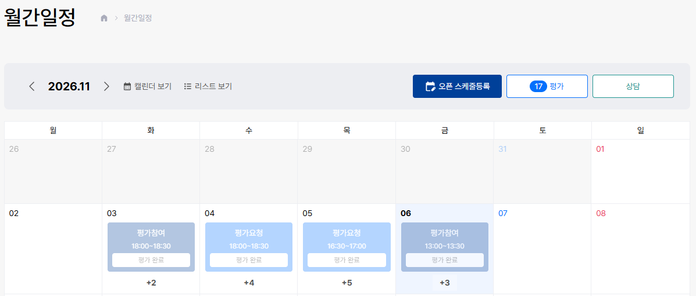
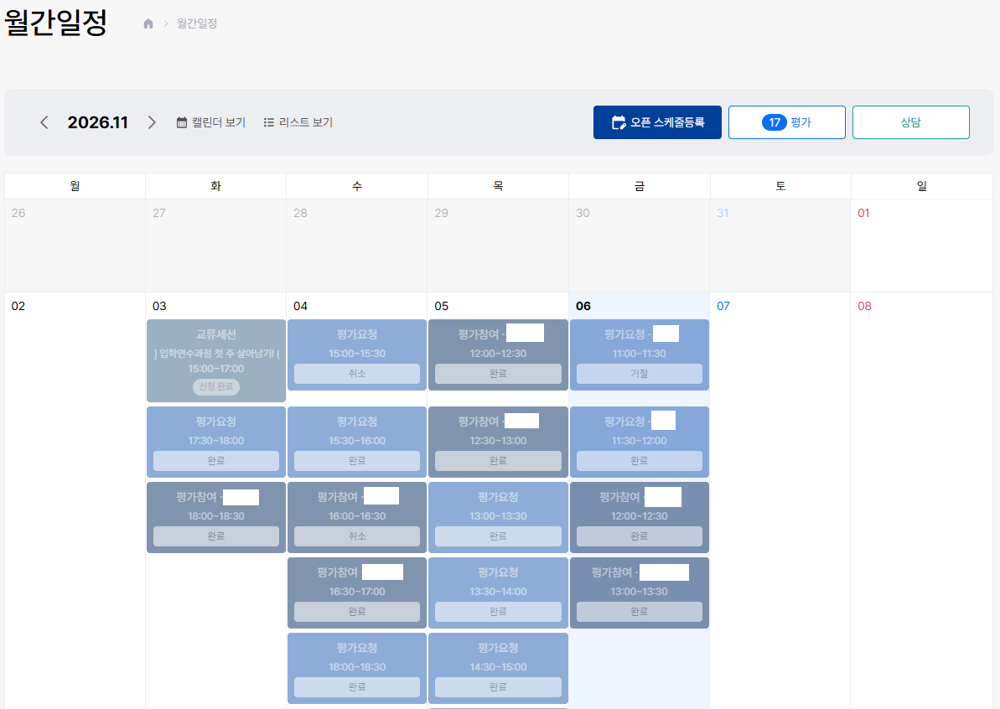
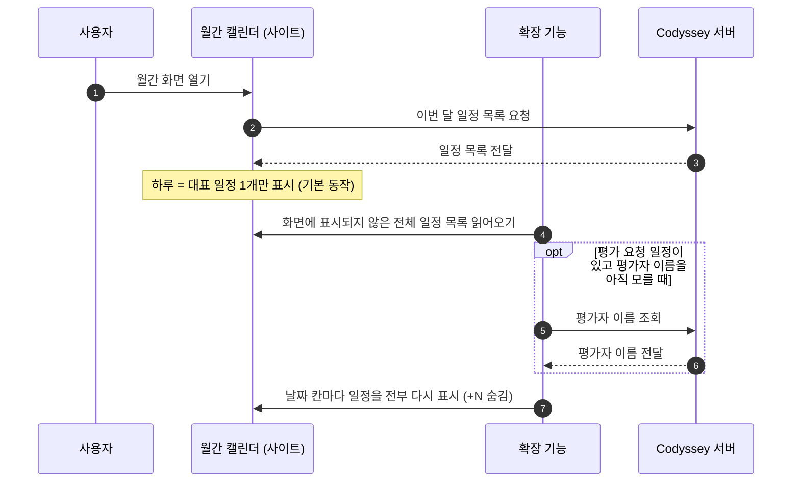
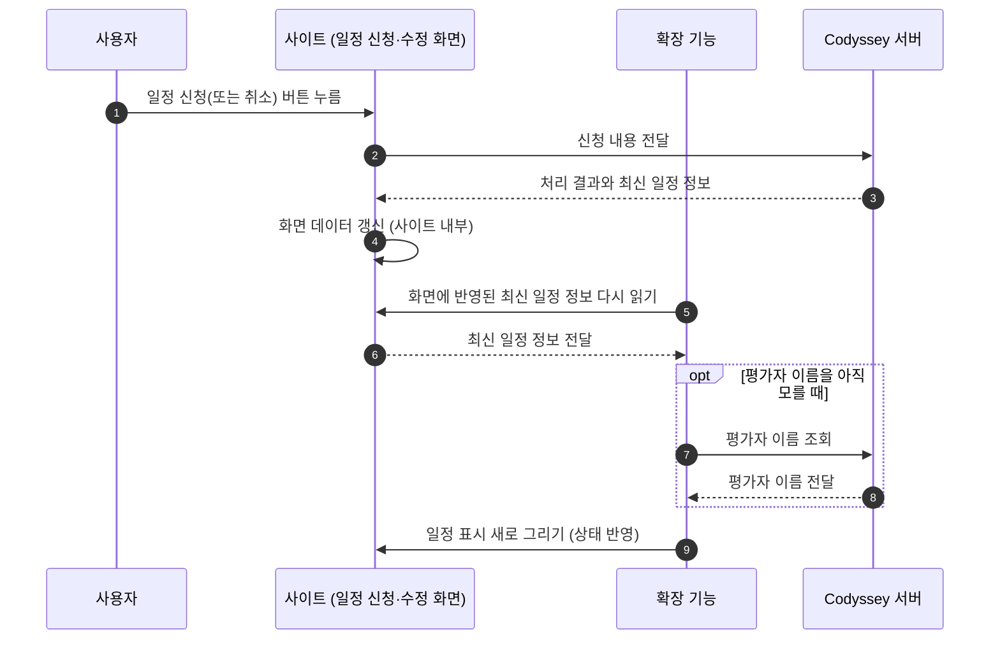

# 추가 기능 명세: 월간 캘린더의 모든 일정 표시

> 명세 버전: 2026-11-06 · 구현: `content.js`(CIM 2026-11-05-rbc-v36), `styles.css`

## 1. 이 기능은 무엇을 하는가

Codyssey 사이트의 월간 평가 일정 화면(`/main/month`)은 하루에 여러 일정이 등록되어 있을 때, **대표 일정 1개만 칸에 보여주고 나머지는 `+N`라는 글자로 갯수만 표시**합니다. 예를 들어 11월 3일에 일정이 5개 있어도 화면에는 2개만 보이고 `+3`만 남습니다. 이렇게 하면 일정이 실제로 화면에 누락되어, 사용자가 일부러 그 날짜를 클릭해야만 모든 일정을 알 수 있습니다.

이 기능(브라우저 확장 "Codyssey Improved")은 **같은 월간 캘린더에서 하루의 모든 일정을 그 날짜 칸 안에 그대로 전부 보여주도록** 바꿉니다. 구글 캘린더처럼 여러 일정이 세로로 쌓여 목록을 따로 열지 않고도 한눈에 다 보입니다.

## 2. 개선 전과 후

| 항목 | 개선 전 (사이트 기본 동작) | 개선 후 (이 기능 적용) |
|---|---|---|
| 하루의 여러 일정 | 대표 1개만 표시 | 등록된 모든 일정 표시 |
| `+N` 버튼 | 숨겨진 갯수를 보여줌 | 사라짐 |
| 일정이 많은 주(주간 행) | 높이가 고정되어 잘림 | 내용에 맞춰 자동으로 늘어남 |
| 일정이 적은 날 | *(변화 없음)* | 불필요하게 커지지 않음 |
| 캘린더 가로 폭·날짜 열 | *(변화 없음)* | 그대로 유지 |

### 실제 화면 비교 (2026년 11월)

| AS-IS: 확장 끈 상태 (사이트 기본) | TO-BE: 확장 켠 상태 (이 기능) |
|---|---|
|  |  |

- AS-IS: 3일 `+2`, 4일 `+4`, 5일 `+5`, 6일 `+3` — 대표 일정 외 나머지는 갯수로만 표시됩니다.
- TO-BE: 3~6일의 모든 일정이 각 날짜 칸에 표시되고, 일정이 많은 주는 높이가 자동으로 늘어납니다.
- 화면 캡처의 개인 이름은 가림 처리했습니다.

## 3. 적용 범위

- 월간 평가 일정 화면에만 적용됩니다. 사이트의 다른 화면은 아무 영향이 없습니다.
- 새로 캘린더를 만드는 것이 아니라, 기존 캘린더의 일정을 그대로 읽어 다시 표시하는 방식입니다.
- 일정 클릭 시 뜨는 상세 화면, 평가 요청/참여, 오픈 일정 등록 등 기존 기능은 그대로 동작합니다.

## 4. 일정 표시 규칙 (기존 스타일 유지)

날짜 칸에 들어가는 각 일정 정보는 사이트에서 이미 쓰는 표시 형식을 그대로 따릅니다.

| 일정 유형 | 표시 내용 |
|---|---|
| 평가 참여 | 1줄: `평가참여 · 피평가자 이름` / 2줄: 시간 |
| 평가 요청 | 1줄: `평가요청 · 평가자 이름` / 2줄: 시간 |
| 학사·오픈 일정 | 1줄: 일정 종류 / 2줄: 일정 제목 / 3줄: 시간 |
| 상태 표시 | `완료`, `취소`, `신청 가능`, `신청 예정`, `신청 마감`, `신청 완료` 등 |

- 평가 요청 일정의 평가자 이름은 본 일정 목록에는 없어서, 필요할 때 별도로 한 번 조회해 화면에 씁니다. 같은 요청 그룹은 기억해 중복 조회하지 않습니다.
- 여러 일정은 시간 순(이른 시간 위)으로 정렬됩니다.
- 이미 지난 일정, `완료`/`취소` 상태의 일정은 눈에 덜 띄게 옅게 표시됩니다.
- 일정이 화면에 너무 길게 나와 다음 일정과 겹쳐 보이지 않도록 제목이 길면 줄이고 `...`으로 표시합니다.

## 5. 동작 구조

다음 두 흐름도는 이 기능이 사이트와 어떻게 협동하는지를 보여줍니다.

### 5-1. 월간 화면을 열었을 때

### 5-2. 신청/취소 등 사용자 동작 후 화면을 다시 갱신할 때

이 기능은 월간 화면의 어떤 변화가 있어도 일정 표시가 사라지지 않도록, 화면이 다시 그려질 때마다 자신도 같이 다시 그립니다.

이때 확장 기능은 일정 자체를 서버에서 직접 다시 내려받지 않습니다. 서버와의 통신(신청 처리, 일정 목록 갱신)은 사이트가 하고, 확장 기능은 그 결과가 화면에 반영된 후 화면의 최신 정보를 다시 읽어 표시를 새로 그리는 역할만 합니다. 확장 기능이 서버에 직접 요청하는 것은 평가자 이름 조회뿐이며, 이는 5-1에서 이미 설명했습니다.

다시 그리게 되는 순간은 데이터 관점에서 다음과 같습니다: 월(페이지)을 이동했을 때, 일정을 신청·취소·삭제·등록했을 때, 상세 화면이 열리거나 닫혔을 때, 그리고 짧은 시간 동안 반복해서 화면 변화를 확인하는 상태에서 감지되는 기타 변화입니다. 이렇게 하여 신청 후 바로 반영하는 데에도 대개 위 흐름으로 충분합니다. (아래 7절 문제점 참고)

## 6. 안전 장치

- 평가자 이름 조회는 같은 그룹에 한 번만 하고 결과를 잠시 기억합니다. 반복적인 서버 요청을 줄입니다.
- 확장 기능의 재표시 부분이 어떤 이유로 실패하면, 사이트의 기본 표시(+N) 그대로 복구되어 일정이 완전히 사라지지 않습니다.
- 월간 캘린더의 날짜 구조와 가로 폭에는 손대지 않습니다.

<!-- 
## 7. 남은 검증 과제 (현재까지의 한계)

- **신청 직후 상태 반영이 늦을 수 있음**: 실제 화면에서 신청 완료 직후 칩이 `신청 가능`에서 `신청 완료`로 바로 바뀌지 않고, 일정을 한 번 더 클릭해야 바뀌는 현상이 관찰되었습니다. 화면 변화 시점을 찾는 데 있어 아직 놓치는 경로가 있다는 뜻으로, 신청 직후 갱신이 확실히 되는지 실제 서비스에서 재확인이 필요합니다.
- **평가자 이름 매칭 기준 확정**: 일정의 식별자(본 데이터)와 조회한 평가자 정보의 식별자를 어떤 것이 바르게 연결하는지 연구 중인 관계로, 일부 조합에서 이름이 비어 보일 수 있습니다.
- **기준 재확인**: `신청 가능/예정/마감` 표시 기준이 사이트의 기준과 완전히 일치하는지 실데이터로 재확인이 필요합니다.

## 8. 확인 체크리스트 (실제 화면에서)

- [ ] 일정이 1개인 날짜가 기존과 똑같이 보인다
- [ ] 일정이 여러 개인 날의 모든 일정이 보인다 (예: 2026-11-03, 11-04, 11-05, 11-10)
- [ ] `+N` 표시가 더 이상 나오지 않는다
- [ ] 일정이 많은 주에서 주간 행 높이가 자동으로 늘어난다
- [ ] 이전 달/다음 달로 이동해도 동일하게 작동한다
- [ ] 일정이 없는 날짜의 칸 높이가 필요 이상으로 커지지 않는다
- [ ] 일정 제목이 길어도 여러 일정이 겹쳐 보이지 않는다
- [ ] 일정을 클릭하면 기존처럼 상세 화면이 열린다
- [ ] 평가 일정 신청·취소, 오픈 일정 등록이 정상 동작한다 -->

